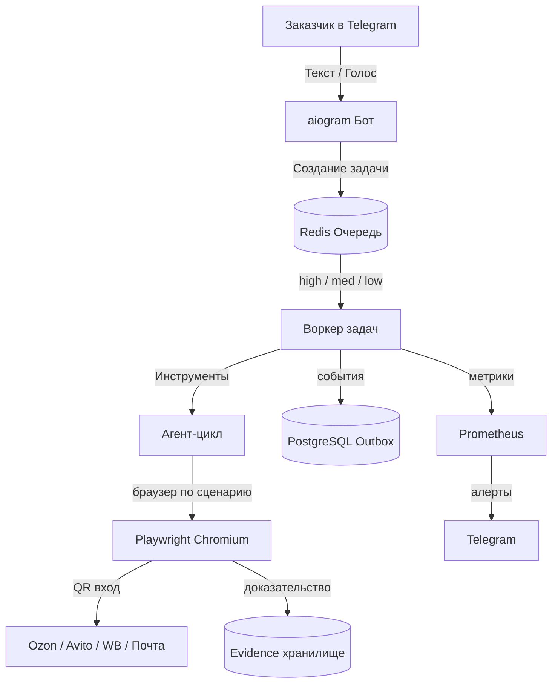

<div align="center">

# 🤖 Персональный помощник-покупатель (MVP)

**Система обслуживания клиентов в браузере на VPS с агентом, очередью задач и доказательством результата.**

<div align="left">

[](https://www.python.org/)
[](https://redis.io/)
[](https://www.postgresql.org/)
[](https://playwright.dev/)
[](https://docs.aiogram.dev/)
[](https://www.docker.com/)
[](https://github.com/ninelegsdog/mvp-browser-agent/actions/workflows/ci.yml)
[](LICENSE)
[](https://github.com/ninelegsdog/mvp-browser-agent/releases/tag/v0.1.0)

</div>

## 🎯 Для кого это решение

Для компаний и частных лиц, которым нужен **персональный помощник покупателя**, который:

- ✅ Работает в реальных кабинетах Ozon, Avito, Wildberries, на сайтах билетов и в электронной почте
- ✅ Живёт на **вашем VPS**, а не на чужом сервере
- ✅ Отвечает в **Telegram** — привычном интерфейсе
- ✅ Показывает **доказательство каждого действия** (скриншот, видео, trace)
- ✅ Требует **подтверждения перед любым необратимым действием** (оплата, оформление заказа)

## 🏆 Почему выбирают это MVP

| Критерий | Решение |
|----------|---------|
| **Где живёт система** | На вашем VPS — полный контроль над данными |
| **Где хранятся сессии** | В профиле Chromium с правами `0700`, вне git |
| **Как входит в кабинеты** | Один раз сканируете QR с телефона — дальше сессия жива |
| **Что делает агент** | Выполняет поручения через инструменты (shell/HTTP/файлы/память), браузер — по сценарию |
| **Как证明ть результат** | Каждый шаг фиксируется: скриншот, видео, единая схема дефекта при сбое |
| **Что если что-то сломается** | Алерт в Telegram в момент сбоя, не через неделю |
| **Кто управляет доступом** | Только вы — через `BOT_ADMIN_ID` в боте |

## 📐 Архитектура



## 📦 Что входит в MVP

### Этап 1. Вход и сессия (9–11 дней)
- Постоянный профиль Chromium через Playwright
- Вход по QR в кабинеты Ozon / Avito / WB / почты
- Проверка «сессия жива» перед каждым поручением
- Профиль `0700`, вне git, отдельные профили по аккаунтам

### Этап 2. Очередь и агент (9–11 дней)
- Задача как состояние: создано → план → шаг → ждёт вас → готово
- Журнал шагов в Telegram: «что сделано / чего ждёт / нужно ваше решение»
- Кнопки: стоп / отменить / продолжить
- Агент выбирает инструменты, не действия в браузере

### Этап 3. Браузерные поручения (10–12 дней)
- Поиск и подбор товара на Ozon, Avito, WB
- Оформление заказа только после вашего подтверждения
- Работа с билетами и электронной почтой
- Учёт лимитов и антибота маркетплейсов

### Этап 4. Надёжность (7–10 дней)
- Мониторинг, алерты в Telegram, автоперезапуск
- Бэкапы и тест восстановления
- Транзакционный outbox: событие не теряется, повтор не создаёт дубль

### Этап 5. Пилот (7–10 дней)
- 20–30 согласованных поручений проверены
- Карточка открывается до 5 сек в типовой сети

**Итого: ≈240 000 ₽ / 22–28 рабочих дней**  
Оплата по факту каждого этапа, предоплата 50 % этапа.

## 🚀 Быстрый старт

```bash
# 1. Клонировать репозиторий
git clone https://github.com/ninelegsdog/mvp-browser-agent.git
cd mvp-browser-agent
git checkout v0.1.0

# 2. Настроить переменные
cp .env.example .env
# Отредактировать .env (BOT_TOKEN, BOT_ADMIN_ID, пароли)

# 3. Запустить инфраструктуру
docker compose -f docker-compose.prod.yml up -d

# 4. Проверить здоровье
curl -s http://localhost:9090/health | python3 -m json.tool

# 5. Запустить бота и воркера
python -m src.telegram_bot &
python -m src.queue worker &
```

## 📁 Структура репозитория

```
mvp-browser-agent/
├── README.md              # Этот файл — торговое предложение
├── CONTRIBUTING.md        # Правила вклада
├── CHANGELOG.md           # История изменений
├── SECURITY.md            # Политика безопасности
├── .env.example           # Шаблон переменных окружения
├── .gitignore             # Защита секретов и профилей
├── Dockerfile             # Multi-stage, UID 1001
├── docker-compose.prod.yml # Продакшен-развёртывание
├── pyproject.toml         # Ruff, pytest, mypy конфигурация
├── requirements.txt       # Пinned зависимости
├── src/                   # Исходный код
│   ├── __init__.py        # v0.1.0
│   ├── config.py          # Pydantic настройки
│   ├── security.py        # Защита от утечек секретов
│   ├── queue.py           # Очередь: приоритеты, DLQ, idempotency
│   ├── agent.py           # Агент-цикл, FSM состояния
│   ├── browser.py         # Playwright, QR-вход, видео
│   ├── proof.py           # Доказательство: defect.v1, read-only
│   ├── outbox.py          # Транзакционный outbox
│   ├── metrics.py         # Prometheus, health check
│   ├── telegram_bot.py    # aiogram бот, админ whitelist
│   └── pages/             # Page Object Model (Ozon и др.)
├── tests/                 # 30 юнит-тестов
├── migrations/            # SQL-миграции (outbox)
├── docs/                  # Документация
│   ├── ARCHITECTURE.md    # Диаграммы и описание компонентов
│   ├── DEPLOYMENT.md      # Инструкция развёртывания
│   ├── API.md             # HTTP API и CLI
│   ├── SECURITY.md        # Политика безопасности
│   └── ROADMAP.md         # Дорожная карта до v1.0.0
├── .github/               # Шаблоны, CI/CD,安全
│   ├── workflows/         # CI, Release, Docs
│   ├── ISSUE_TEMPLATE/    # Bug report, Feature request
│   ├── PULL_REQUEST_TEMPLATE.md
│   ├── CODEOWNERS
│   └── SECURITY.md
└── RUNBOOK.md             # Эксплуатация и устранение инцидентов
```

## 🔒 Безопасность

- **Секреты не в коде:** `.env` в `.gitignore`, ключи в `~/.secrets/keys/` (chmod 600)
- **Секреты не в логах:** `assert_no_secrets_in_text()` блокирует попытку залогировать токены
- **Профили браузера изолированы:** права `0700`, отдельные профили по аккаунтам
- **Необратимые действия только с подтверждением:** FSM требует вашего одобрения в Telegram
- **152-ФЗ:** Определение оператора ПДн, уведомления, трансграничная передача — перед вводом боевых данных

## 📊 Метрики и мониторинг

- `GET /health` — статус Redis и PostgreSQL
- `GET /metrics` — Prometheus метрики (ошибки, длительность, глубина очереди)
- Алерты в Telegram при сбоях сканирования, ошибках 5xx, проблемах с браузером

## 🛣 Дорожная карта

| Версия | Статус | Основное |
|--------|--------|----------|
| **0.1.0** | ✅ Готово | MVP: очередь, агент, браузер, outbox, доказательства, бот, мониторинг |
| 0.2.0 | 📋 План | Page Object Model для Avito/WB, лимиты антибота, покрытие 80% |
| 0.3.0 | 📋 План | Множественные аккаунты, планировщик, веб-интерфейс DLQ |
| 1.0.0 | 📋 План | SLA 99.9%, автоматический rollback, полная документация 152-ФЗ |

## 📞 Контакты и тендер

- **Автор:** Олег, Санкт-Петербург — самозанятый (НПД), работаю по договору
- **Репозиторий:** github.com/ninelegsdog/mvp-browser-agent
- **Демо:** Доступно по запросу в переписке (показываю на тестовых данных)
- **Начать:** В течение недели после согласования объёма

---

<div align="center">

**Готов к обсуждению вашего ТЗ и запуску пилота.**

*Это не просто код — это надёжная система с доказательством каждого действия, готовая к коммерческой эксплуатации.*

</div>

</div>