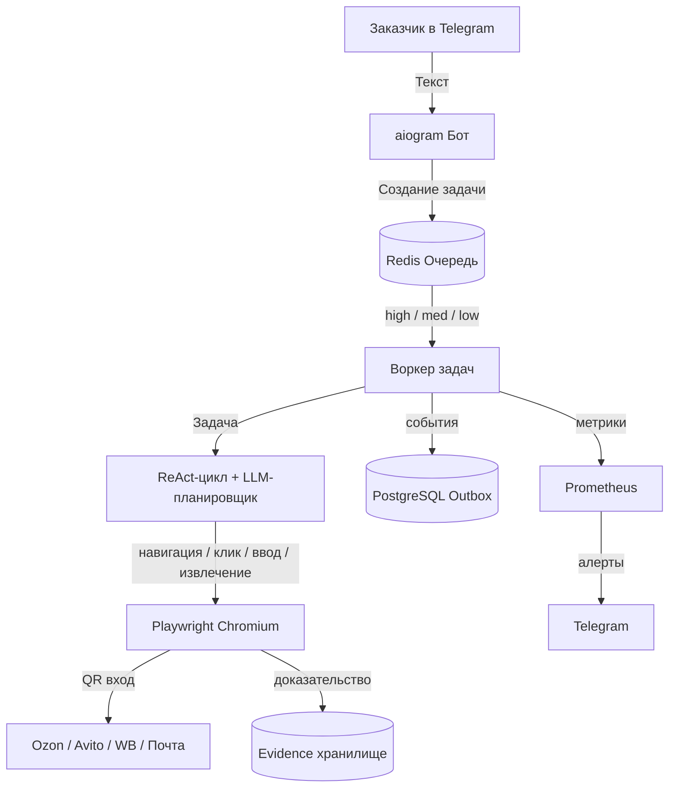

# 🤖 Персональный помощник-покупатель (MVP)

Система обслуживания клиентов в браузере на VPS с агентом, очередью задач и доказательством результата.

> Готовое решение для тендера: фиксированные этапы, публичный код, доказательство каждого действия, поддержка 152-ФЗ.

[](https://www.python.org/)
[](https://redis.io/)
[](https://www.postgresql.org/)
[](https://playwright.dev/)
[](https://docs.aiogram.dev/)
[](https://www.docker.com/)
[](https://github.com/ninelegsdog/mvp-browser-agent/actions/workflows/ci.yml)
[](https://github.com/ninelegsdog/mvp-browser-agent/releases/tag/v0.3.0)
[](LICENSE)

---

## Содержание

- [Для кого это решение](#для-кого-это-решение)
- [Почему выбирают это MVP](#почему-выбирают-это-mvp)
- [Архитектура](#архитектура)
- [Быстрый старт](#быстрый-старт)
- [Структура репозитория](#структура-репозитория)
- [Полная документация](#полная-документация)
- [Безопасность](#безопасность)
- [Метрики и мониторинг](#метрики-и-мониторинг)
- [Дорожная карта](#дорожная-карта)

---

## Для кого это решение

Для компаний и частных лиц, которым нужен **персональный помощник покупателя**, который:

- ✅ Работает в реальных кабинетах Ozon, Авито, Wildberries, на сайтах билетов и в электронной почте
- ✅ Живёт на **вашем VPS** — полный контроль над данными
- ✅ Отвечает в **Telegram** — привычном интерфейсе
- ✅ Показывает **доказательство каждого действия** (скриншот, видео, trace)
- ✅ Требует **подтверждения перед любым необратимым действием** (оплата, оформление заказа)
- ✅ **Сам выбирает действие в браузере** и меняет план после обычного уточнения в чате

---

## Почему выбирают это MVP

| Критерий | Решение |
|----------|---------|
| Где живёт система | На вашем VPS — полный контроль над данными |
| Где хранятся сессии | В профиле Chromium с правами `0700`, вне git |
| Как входит в кабинеты | Один раз сканируете QR с телефона — дальше сессия жива |
| Что делает агент | Цикл «мысль → действие → результат»: модель выбирает инструмент (браузер, shell из белого списка, HTTP, файлы, память) и пересматривает план после вашего уточнения |
| Как подтвердить результат | Каждый шаг фиксируется: скриншот, видео, единая схема дефекта при сбое |
| Что если что-то сломается | Алерт в Telegram в момент сбоя, не через неделю |
| Кто управляет доступом | Только вы — через `BOT_ADMIN_ID` в боте |

---

## Архитектура



---

## Быстрый старт

```bash
# 1. Клонировать репозиторий
git clone https://github.com/ninelegsdog/mvp-browser-agent.git
cd mvp-browser-agent

# 2. Настроить переменные окружения
cp .env.example .env
nano .env   # BOT_TOKEN, BOT_ADMIN_ID, LLM_API_KEY, пароли БД и Redis

# 3. Проверить, что все данные на месте (до первого запуска)
python scripts/preflight.py
# [OK] BOT_TOKEN / BOT_ADMIN_ID / LLM_API_KEY / Chromium ...
# ИТОГ: обязательные данные на месте. Можно запускать.

# 4. Войти по QR в кабинет (один раз, руками, с телефона)
python scripts/qr_login.py --url https://www.ozon.ru \
    --success-selector "<селектор кабинета>" --show
# ИТОГ: вход подтверждён (код 0)

# 5. Запустить инфраструктуру
docker compose -f docker-compose.prod.yml up -d

# 6. Проверить здоровье и сеть
python scripts/preflight.py --network
curl -s http://localhost:9090/health | python3 -m json.tool

# 7. Запустить бота и воркера
python -m src.telegram_bot &
python -m src.queue worker &
```

> **Важно:** без заполненного `.env` бот не запустится. Все секреты хранятся только локально и не попадают в git.
>
> Полный список данных, которые нужны от заказчика, — [`docs/CLIENT-START.md`](docs/CLIENT-START.md).

---

## Структура репозитория

```text
mvp-browser-agent/
├── README.md              # Этот файл — торговое предложение
├── SECURITY.md            # Политика безопасности
├── CONTRIBUTING.md        # Правила вклада
├── CHANGELOG.md           # История изменений
├── RUNBOOK.md             # Эксплуатация и устранение инцидентов
├── .env.example           # Шаблон переменных окружения
├── .gitignore             # Защита секретов и профилей
├── Dockerfile             # Multi-stage, UID 1001, non-root
├── docker-compose.prod.yml # Продакшен-развёртывание
├── pyproject.toml         # Ruff, pytest, mypy конфигурация
├── requirements.txt       # Пinned зависимости
├── LICENSE                # MIT License
├── src/                   # Исходный код
│   ├── __init__.py        # v0.1.0
│   ├── config.py          # Pydantic настройки
│   ├── security.py        # Защита от утечек секретов
│   ├── queue.py           # Очередь: приоритеты, DLQ, idempotency
│   ├── agent.py           # ReAct-цикл, FSM состояния, resume()
│   ├── autonomous_planner.py # LLM выбирает действие, разбор JSON
│   ├── browser_tool.py    # Действия в браузере: navigate/click/fill/extract
│   ├── browser.py         # Playwright, QR-вход, видео
│   ├── proof.py           # Доказательство: defect.v1, read-only
│   ├── outbox.py          # Транзакционный outbox
│   ├── metrics.py         # Prometheus, health check
│   ├── telegram_bot.py    # aiogram бот, админ whitelist
│   └── pages/             # Page Object Model (Ozon и др.)
├── scripts/               # preflight.py, qr_login.py, daily_report.py
├── tests/                 # 121 тестов: юнит, контрактные, интеграционные
├── migrations/            # SQL-миграции (outbox)
├── docs/                  # Полная документация
│   ├── CLIENT-START.md    # Что нужно от заказчика для старта
│   ├── ARCHITECTURE.md    # Диаграммы и описание компонентов
│   ├── DEPLOYMENT.md      # Инструкция развёртывания (6 шагов)
│   ├── API.md             # HTTP API и CLI
│   ├── SECURITY.md        # Политика безопасности и 152-ФЗ
│   └── ROADMAP.md         # Дорожная карта до v1.0.0
└── .github/               # CI/CD, шаблоны Issues/PR, CODEOWNERS
    ├── workflows/         # CI, Release, Docs
    ├── ISSUE_TEMPLATE/    # Bug report, Feature request
    ├── PULL_REQUEST_TEMPLATE.md
    └── SECURITY.md
```

---

## Полная документация

| Раздел | Файл | Содержание |
|--------|------|-----------|
| Старт проекта | [`docs/CLIENT-START.md`](docs/CLIENT-START.md) | Что нужно от заказчика: каждый пункт с проверкой |
| Архитектура | [`docs/ARCHITECTURE.md`](docs/ARCHITECTURE.md) | Mermaid-диаграммы, модель безопасности, стек технологий |
| Развёртывание | [`docs/DEPLOYMENT.md`](docs/DEPLOYMENT.md) | Пошаговая инструкция для VPS заказчика (6 шагов) |
| API и интеграция | [`docs/API.md`](docs/API.md) | HTTP API (`/health`, `/metrics`), CLI очереди, JSON-схемы |
| Безопасность | [`docs/SECURITY.md`](docs/SECURITY.md) | Принципы безопасности, соответствие 152-ФЗ |
| Дорожная карта | [`docs/ROADMAP.md`](docs/ROADMAP.md) | План развития до v1.0.0 |

---

## Безопасность

- **Секреты не в коде:** `.env` в `.gitignore`, ключи в `~/.secrets/keys/` (chmod 600)
- **Секреты не в логах:** `assert_no_secrets_in_text()` блокирует попытку залогировать токены
- **Профили браузера изолированы:** права `0700`, отдельные профили по аккаунтам (Ozon, Авито, WB, почта);
  шифрование профиля для бэкапа — флаг `BROWSER_PROFILE_ENCRYPTION`
- **Необратимые действия только с подтверждением:** FSM требует вашего одобрения в Telegram
- **152-ФЗ:** Определение оператора ПДн, уведомления, трансграничная передача — перед вводом боевых данных

---

## Метрики и мониторинг

| Ресурс | Путь | Назначение |
|--------|------|-----------|
| Health check | `GET /health` | Статус Redis и PostgreSQL |
| Метрики | `GET /metrics` | Prometheus метрики (ошибки, длительность, глубина очереди) |
| Алерты | Telegram | При сбоях сканирования, ошибках 5xx, проблемах с браузером |

---

## Дорожная карта

| Версия | Статус | Основное |
|--------|--------|----------|
| 0.1.0 | ✅ Готово | MVP: очередь, агент, браузер, outbox, доказательства, бот, мониторинг |
| 0.2.0 | ✅ Готово | Реальный браузерный инструмент, не-headless запуск, шифрование профиля |
| **0.3.0** | ✅ Готово | ReAct-цикл с выбором действий моделью, подтверждение необратимых шагов, `preflight.py`, `qr_login.py`, `CLIENT-START.md` |
| 0.4.0 | 📋 План | Page Object Model для Авито/WB, лимиты антибота, покрытие тестами 80% |
| 1.0.0 | 📋 План | SLA 99.9%, автоматический rollback, полная документация 152-ФЗ |

---
