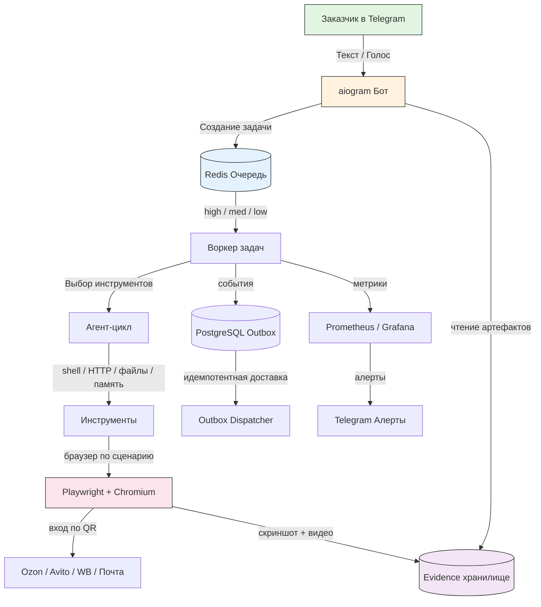
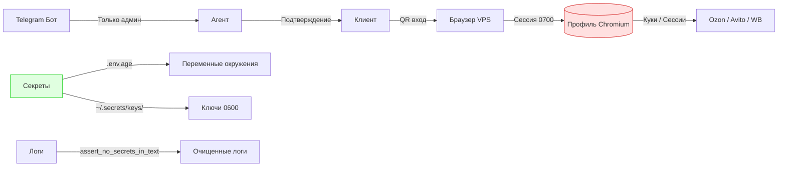

# Архитектура MVP: Персональный помощник-покупатель

Этот документ описывает систему с точки зрения архитектуры, чтобы заказчик мог оценить надёжность и масштабируемость перед подписанием договора.

## Общая схема

## Компоненты

### 1. Очередь задач (`src/queue.py`)
- **Реализация:** Redis (`LPUSH` producer / `BLPOP` consumer)
- **Приоритеты:** `high` → `med` → `low` (строгая очередь через шардирование)
- **Надёжность:** Retry-or-DLQ (2 повтора, затем `queue:dead`)
- **Идемпотентность:** `idempotency_key` защищает от дублей
- **TTL:** Задачи старше 24 часов пропускаются
- **Грейсфул шатдаун:** Завершает in-flight задачи перед выходом

### 2. Агент-цикл (`src/agent.py`)
- **Модель выбирает инструменты**, не действия в браузере
- **Инструменты:** shell, HTTP, файлы, память, браузер (по сценарию)
- **Состояние задачи:** создано → план → шаг → ждёт вас → готово
- **FSM:** Подтверждение пользователя перед необратимыми действиями

### 3. Браузерная автоматизация (`src/browser.py`)
- **Реализация:** Playwright + постоянный профиль Chromium
- **Вход:** QR-код (один раз с телефона, сессия сохраняется)
- **Безопасность:** Профиль `0700`, вне git, отдельные профили по аккаунтам
- **Доказательство:** Скриншот + видео + метаданные на каждом шаге

### 4. Доказательство результата (`src/proof.py`)
- **Схема:** `defect.v1` при сбое, `result.v1.json` при успехе
- **Read-only:** Агент читает артефакты, не может их модифицировать
- **Хранение:** `evidence/<task_id>/` — версияция прогона

### 5. Транзакционный outbox (`src/outbox.py`)
- **Реализация:** PostgreSQL таблица `outbox`
- **Гарантия:** Событие пишется в ту же транзакцию, что и бизнес-изменение
- **Доставка:** `OutboxDispatcher` — при сбое публикации прерывает цикл (сохраняет порядок)
- **Идемпотентность:** Redis Stream ID `f"{event.id}-0"` для дедупликации

## Модель безопасности

## Стек технологий

| Слой | Технология | Версия |
|------|-----------|--------|
| Язык | Python | 3.12 |
| Очередь | Redis | 7 |
| БД | PostgreSQL | 15 |
| Браузер | Playwright + Chromium | 1.49 |
| Бот | aiogram | 3.4 |
| Конфигурация | pydantic-settings | 2.16 |
| Мониторинг | Prometheus client | 0.26 |
| Веб | aiohttp | 3.11 |
| Контейнеризация | Docker | multi-stage |
